# Foreward

"I got tired of X, so I built Y". Today's subject: [Immich](https://github.com/immich-app/immich). 

This is a 100% vibe coded personal project to take what I liked from Immich and focus less on "normal users and families wanting a direct replacement for Google Photos" and more on managing/searching through a large library of unsorted images, particularly artwork. 

I aimed to improve the two main things Immich was and still is severly lacking in support: flexible and powerful searching, and streamlined tagging workflows. Additional features include a color palette manager (similar to [colorhunt](https://colorhunt.co/)), and other currently untested features (including an image queue for saving art/reference for study and a random session runner for drawing study)

With that out of the way, here's the current AI slop readme:

# refr

Self-hosted, single-user reference-image manager for artists. Point it at the folders where
your images already live. refr indexes them by content hash without modifying them, then
gives you hierarchical tags, a booru-style search, and tools for studying from references:
a study queue, timed drawing sessions, moodboards, and color palettes.

See [refr](refr.md) for the vision and [SPEC](SPEC.md) for the implementation outline.

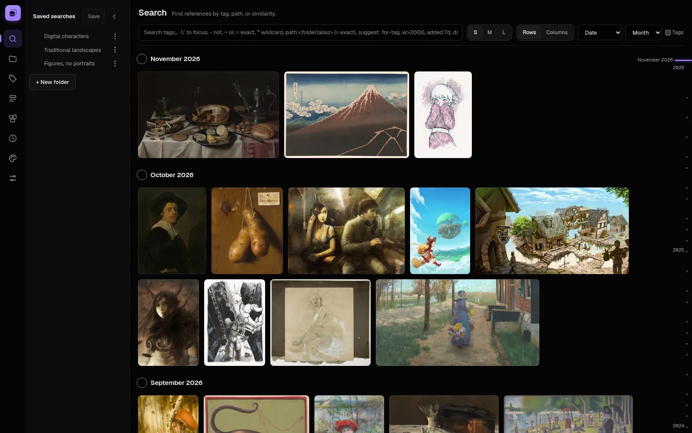

<sub>All screenshots show a demo library of public-domain paintings and prints from the Art
Institute of Chicago, plus Creative Commons digital art by David Revoy. See
[credits](docs/screenshots/CREDITS.md).</sub>

## Highlights

- **Your files stay where they are.** Libraries are read-only. A file's identity is its
  sha256, so renames, moves, and duplicate copies keep their tags.
- **Hierarchical tags.** `subject/landscape/mountains`, `medium/traditional/watercolor`,
  `artist/katsushika hokusai`. Searching a parent tag also matches its children.
- **Search built from tag chips.** Supports AND, NOT, OR, exact match, wildcards, metadata
  filters (size, date, orientation, tag count), folder paths, and optional semantic
  search.
- **Tagging workflow.** Optional local CLIP/SigLIP embeddings suggest tags per image, find
  likely untagged matches for each tag, and learn from what you accept or reject.
- **Study tools.** The fullscreen viewer has flip, grayscale, squint blur, value
  posterization, and composition grids. Use them on their own or during timed drawing
  sessions.
- **Queue, sessions, boards, palettes.** Collect images to study, run randomized timed
  sessions, arrange moodboards, and pull color palettes from any image.
- **Plain-text user data.** Settings are a YAML file. Queues, sessions, palettes, boards,
  and saved searches are JSON files you can read, diff, and back up.
- **Built for large libraries.** Lists are paginated and virtualized, and scans,
  thumbnails, and embeddings run in the background. It is designed for 100k+ images.

## Run

Requires Node.js (the project uses Next.js 15).

```bash
npm install
npm run dev          # or: npm run build && npm start
```

Then open <http://localhost:3000>, go to **Settings → Libraries**, add one or more folder
paths, and click **Scan now**.

Data directory resolution: `--data <dir>` flag > `DATA_DIR` env > `./data`.
First boot creates `config.yaml`, `refr.db`, `.secret`, and subdirs there:

```
data/
  config.yaml     # all settings (editable by hand; the UI picks up changes)
  refr.db         # SQLite: files, paths, tags, embeddings
  thumbnails/     # 2-hex sharded webp thumbnails
  queues/  sessions/  palettes/  boards/  searches/   # plain JSON
```

A minimal `config.yaml`:

```yaml
passwordHash: null          # null = no login (trusted network); set a password in Settings
libraries:
  - path: /mnt/art/
    alias: art              # lets you search path:art
    timeline: true          # include in the main timeline
scanTime: "03:00"           # nightly rescan, or null to disable
sendToPaths: []             # folders "Send to" may copy files into
theme: obsidian
accent: violet
density: comfortable
ml:
  enabled: false
```

Video thumbnails/probing require system `ffmpeg`/`ffprobe` on PATH (optional — without
them videos still index, just without thumbs/dimensions).

Semantic (CLIP) features are off by default; enable in Settings. Requires system
python ≥ 3.10 — first enable creates `ml/.venv/` and downloads several GB
(torch + model weights). The default model is SigLIP 2 (`ViT-B-16-SigLIP2`); a CUDA GPU is
used when available. ML powers *Find similar*, semantic text search, tag suggestions, the
Tagging page, and board suggestions. Everything else works without it.

## Tour

### Search

Each search term is a chip, so tags with spaces stay unambiguous. Typing shows fuzzy
autocomplete, and the URL holds the full query, so you can bookmark or share any search.
Toggle **Tags** to show each image's tags on its thumbnail. Searches you use often can be
saved to the sidebar.

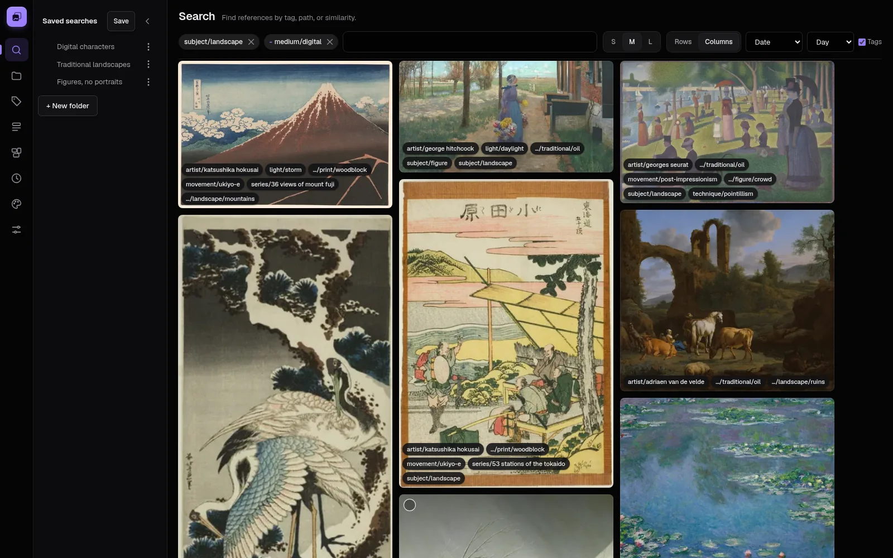

| Syntax | Meaning |
|---|---|
| `subject/figure` | has the tag **or any descendant** (`subject/figure/gesture`, …) |
| `-medium/digital` | NOT |
| `~movement/impressionism ~movement/ukiyo-e` | OR group |
| `=subject/figure` | exact tag only, no descendants |
| `artist/*`, `*/watercolor` | wildcard over the full tag path |
| `untagged`, `tagged`, `missing` | metadata keywords |
| `type:image`, `type:video`, `orient:portrait` | media type / orientation |
| `wallpaper:any`, `wallpaper:16:9`, `wallpaper:16:10`, `wallpaper:21:9` | images ≥720 px tall at a wallpaper aspect ratio |
| `w>2000`, `h<=1080`, `tags=0` | dimensions / tag count |
| `added:7d`, `date:2024-03` | added recently / file date (d, w, m, y) |
| `path:<folder or alias>` | files in a folder (`=path:` for direct children only) |
| `suggest:<tag>` | images the model thinks belong in `<tag>` *(ML)* |
| `"a stormy sea at dusk"` | semantic text search *(ML)* |

Modifiers combine, with `-`/`~` before `=`: `-=reference/figure`, `~=artist/x`,
`-*nsfw*`.

**Find similar** (from any image's context menu) searches by visual similarity:

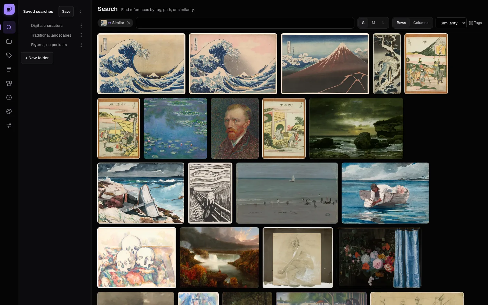

### Browse

You can browse by tag tree or by folder tree. Each tag node shows its file count and can
be renamed, merged, or deleted across the whole library. When ML is enabled, each tag page
also shows **image suggestions**: likely matches that don't have the tag yet. Accept them
with ✓ or dismiss them with ✕.

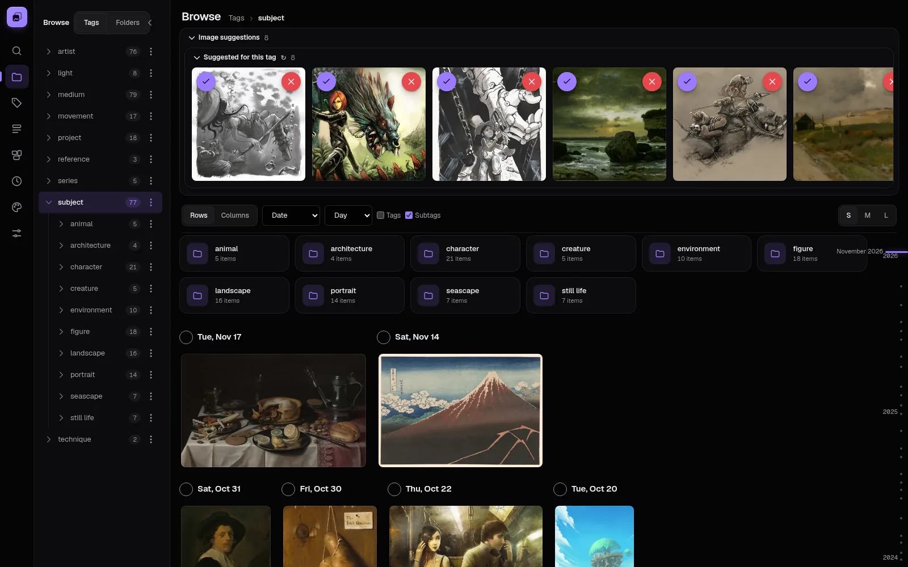

### Viewer and study tools

The fullscreen viewer has a metadata panel, a tag panel with fuzzy autocomplete and
suggested tags, and a filmstrip. Navigate with the arrow keys, swipe on touch devices, and
zoom in to inspect detail.

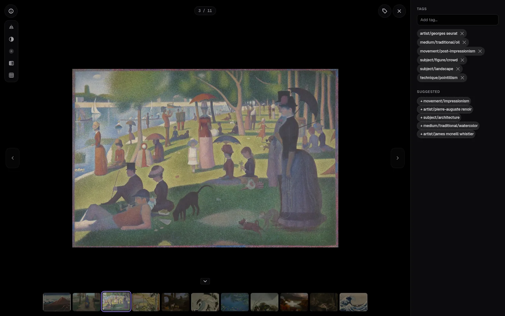

| Key | Action | | Key | Action |
|---|---|---|---|---|
| `←` `→` | previous / next | | `H` | flip horizontally |
| `F` | toggle panels | | `G` | grayscale |
| `Esc` | close | | `U` | squint blur |
| `0` | reset zoom | | `V` | value steps (2 / 3 / 5) |
| | | | `R` | grid overlay (thirds / 4×4) |

Shortcuts on grid tiles: `Q` queue, `T` add tag, `Shift+T` remove tag, `P` palette, `S`
send to, `B` add to board, `Ctrl/⌘+I` invert selection. Right-click any tile (or a
selection) for the same actions.

### Tagging

The **Tagging** page goes through your tags in batches. For each tag it shows the images
the model is confident about, alongside a few you've already tagged for comparison. Click
an image to cycle it through accept, reject, and skip, then commit the batch. Rejections
train a per-tag classifier, so suggestions improve over time. A confidence slider sets the
threshold.

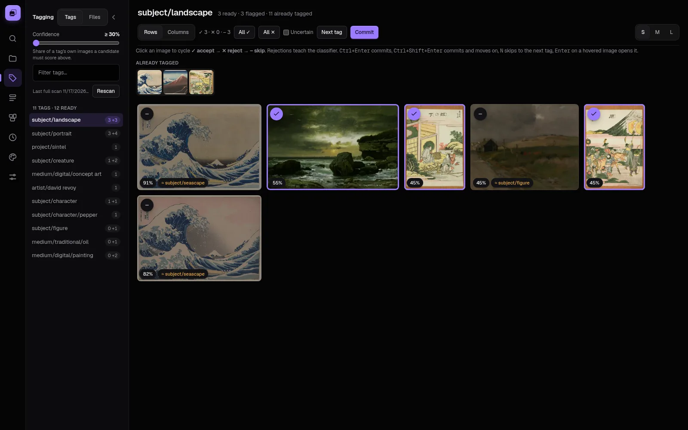

The **Rules** view holds tag aliases and implications. An alias makes a shorthand stand
for another tag when tagging and searching (`fig` → `reference/figure`). An implication
adds more tags automatically (`artist/x` ⇒ `medium/digital`). Rules are stored in
`data/tag-rules.json` and can be applied retroactively to existing files.

The **Files** view works the other way around: it lists your newest files with their most
confident tag matches, so you can tag new images as they arrive.

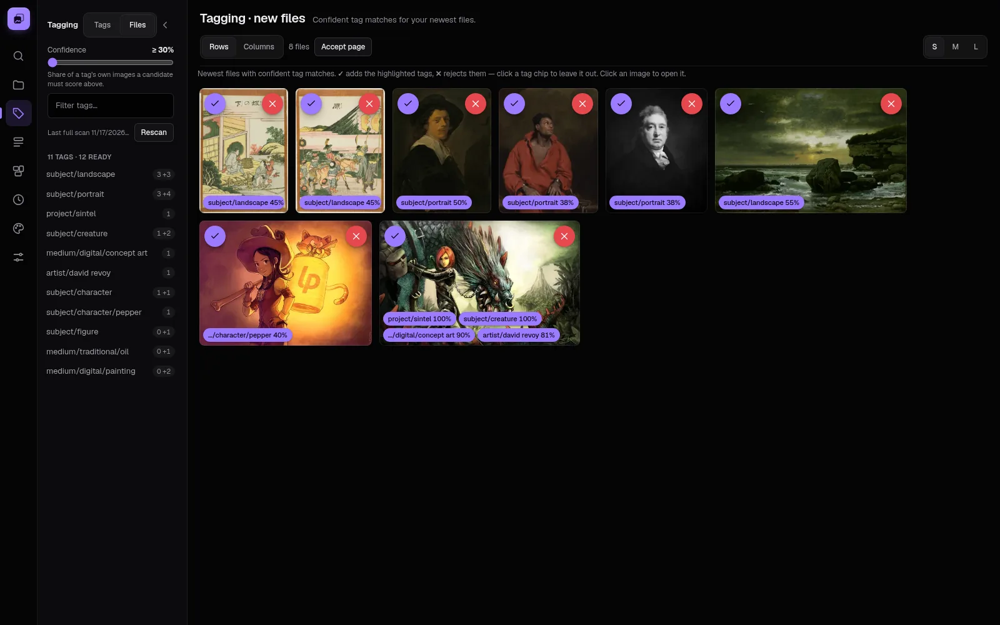

### Queue

The queue holds images you want to study later. Add an image from anywhere with `Q`, then
reorder by dragging or with `Alt+←/→`. You can save a queue to a named JSON file and load
it again later.

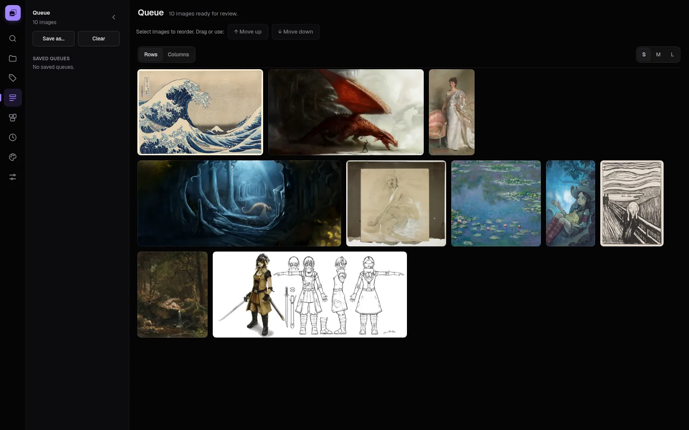

### Sessions

A session is a randomized drawing practice set, built from rows of *tag × count × time*.
For example: 10 figures at 30 s, then 5 at 1 min, then 2 portraits at 5 min. A row can
advance automatically when its time runs out, or flash and wait for you. You can snooze
the timer by +30 s, +1 m, +5 m, or +10 m. Each run is saved to a per-session history, so
you can redo the same set of images later.

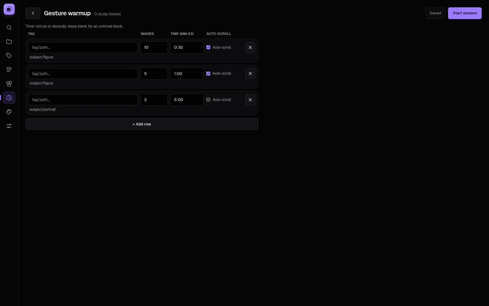

Sessions run in the regular viewer, so the study tools still work. Here a landscape value
study is running with 3-value posterization and a rule-of-thirds grid:

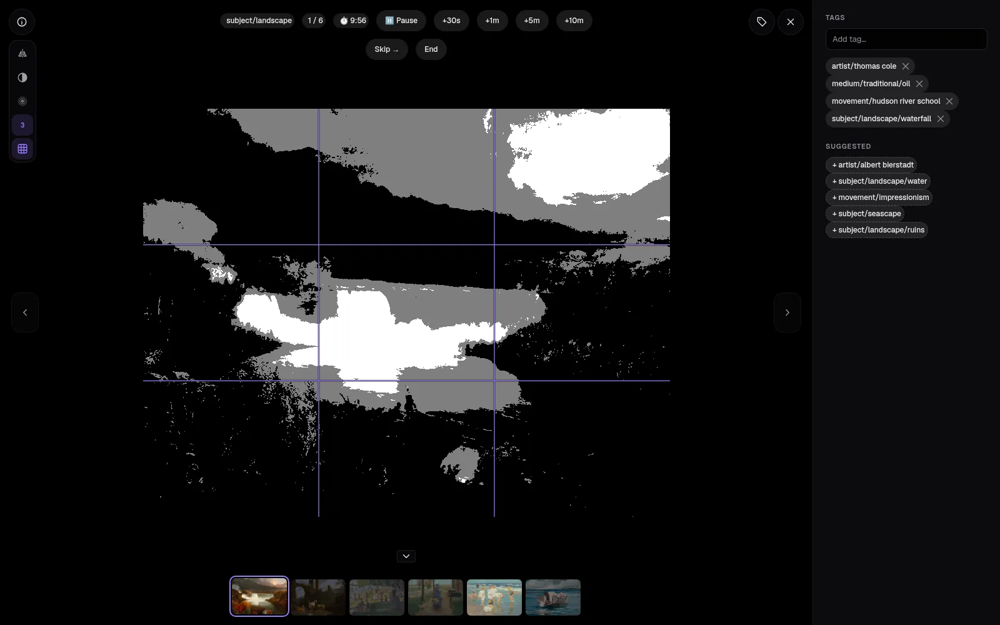

### Boards

Boards are infinite-canvas moodboards. You can move, scale, rotate, and flip images, add
Markdown text notes and arrows, and apply per-image study filters (for example, the 3-value
Great Wave below). The side panel suggests visually related images from your library.

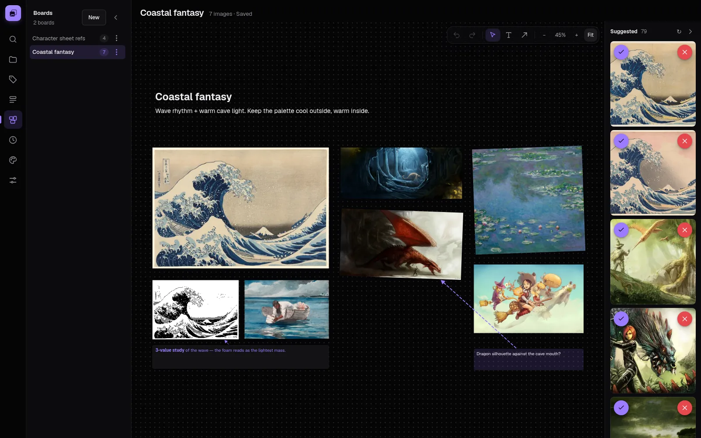

### Palettes

Palettes are stored as colorhunt-style swatch cards, one JSON file each, and can be sorted
into folders. **Create palette** on any image extracts its dominant colors (up to 10). You
can then reorder swatches, adjust them, or pick replacements from the image with an
eyedropper. Palettes can be exported as a striped PNG, and any swatch can be copied as hex.

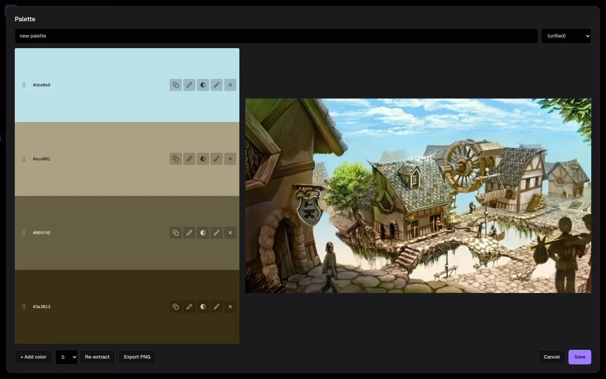

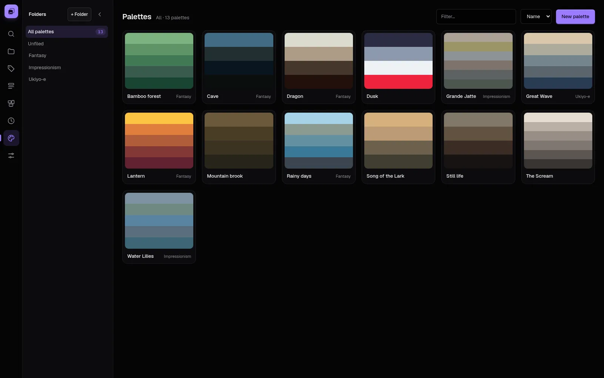

### Themes

refr has five themes (Obsidian, Midnight, Dusk, Fog, Paper), eight accent colors, and
three density levels. All of them can be set in Settings or `config.yaml`. Here is Paper
with the teal accent:

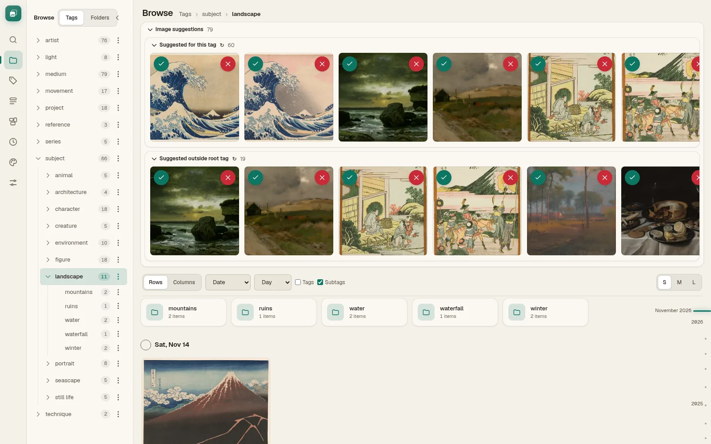

## Test

```bash
npx vitest run       # service-level tests (search SQL, tags, scanner, sessions, palette, ml stub)
npm run check        # lint + typecheck
```

## Screenshot credits

The demo library contains public-domain works from the
[Art Institute of Chicago](https://www.artic.edu/open-access/open-access-images) (CC0),
including works by Hokusai, Monet, Seurat, Homer, Sargent, and Munch. It also contains
digital paintings and concept art by [David Revoy](https://www.davidrevoy.com/)
(*Pepper&Carrot*, and *Sintel* © Blender Foundation), used under CC BY 3.0 / 4.0 and
CC BY-SA 4.0. The full per-image list is in [docs/screenshots/CREDITS.md](docs/screenshots/CREDITS.md).
